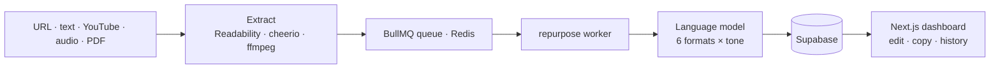

<div align="center">



<p>
  
  
  
  
</p>

<p><em>Turn one blog post, YouTube video or podcast into six platform-ready formats at once.<br>
Paste your content, pick the formats, get results in about thirty seconds.</em></p>

</div>


## What it is

ContentForge is a content repurposing SaaS. No more rewriting the same idea for LinkedIn, X, a newsletter and Instagram: feed it once, choose a tone, and edit the results in the browser before you copy them out. Turkish and English, a dark premium interface, and self-hosted on your own server.

| | |
|---|---|
| **6 output formats** | LinkedIn post, X thread, newsletter, Shorts script, carousel plan, blog summary. |
| **5 input sources** | Blog URL, raw text, YouTube link, audio / podcast upload, PDF. |
| **5 tones** | Professional, casual, humorous, inspirational, educational. |
| **Inline editing** | Edit any result directly, then copy or re-export. |
| **Dashboard and history** | Usage stats, recent conversions and a filterable history. |
| **Templates** | Ready prompt templates for common jobs. |
| **Plans** | Free, Starter and Pro through Lemon Squeezy, with API access on Pro. |


## How it works



Deployment is a Docker Compose stack (app, worker, Redis) behind Caddy with automatic TLS.


## Türkçe özet

**ContentForge**, içerik üreticilerinin tek bir kaynaktan (blog yazısı, YouTube videosu, podcast) farklı platformlara uygun altı formatı aynı anda üretmesini sağlayan bir SaaS. İçeriği yapıştırıp formatları ve tonu seçiyorsun, sonuçlar yaklaşık otuz saniyede geliyor ve tarayıcıda düzenlenebiliyor. Türkçe ve İngilizce; Docker ile kendi sunucunda çalışıyor.


## Development

```sh
npm install
cp .env.example .env.local      # Supabase, AI provider, Redis, Lemon Squeezy
npm run dev                     # Next.js
npm run worker                  # repurpose worker
docker compose -f docker/docker-compose.yml up -d   # production stack
```

<div align="center">
<br>
<a href="https://github.com/kutluhangil"></a>
<sub>Write once. Publish everywhere.</sub>
</div>
