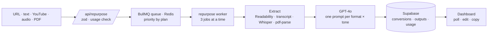

<div align="center">


<p>
  
  
  
  
</p>

<p><em>Write once, publish everywhere. Paste a blog post, a YouTube link, a podcast or a PDF,<br>
pick formats and a tone, and get a LinkedIn post, an X thread, a newsletter and more, ready to edit.</em></p>

</div>


## The idea

Anyone who publishes ends up rewriting the same idea five times: a LinkedIn post, a thread, a newsletter section, a short-video script, a carousel. ContentForge takes one source and does those rewrites together. Each format has its own prompt that knows the platform's shape, the tone applies to all of them, and every result opens in an editor before you copy it out.

> **The heavy work runs off the request.** Extracting a transcript or a PDF and calling the model can take a while, so a conversion is a job on a Redis queue. The page polls its status; the browser never waits on a long request, and Pro jobs jump the queue.


## Features

| | |
|---|---|
| **Five sources** | A blog URL (cleaned with Readability), raw text, a YouTube link (transcript), an audio or podcast upload (Whisper transcription), or a PDF. |
| **Six formats** | LinkedIn post, X thread, newsletter, Shorts / Reels script, carousel plan and blog summary, each from its own prompt. |
| **Five tones** | Professional, casual, humorous, inspirational and educational. |
| **Inline editing** | Edit any result in place, then copy or export it. |
| **Templates** | Ready setups for common jobs, so a weekly routine is one click. |
| **Dashboard** | Conversions this month, the usage bar against your plan, and recent jobs. |
| **History** | Every conversion with its outputs, kept for as long as your plan allows. |
| **Plans and billing** | Free, Starter and Pro through Lemon Squeezy checkout, with monthly or yearly billing, cancel from settings and signed webhooks. |
| **API keys** | A settings page for Pro keys. The screen is in place; issuing and checking keys on the server is still to be wired.
| **TR / EN, dark and light** | Locale-prefixed routes with `next-intl`, a theme switch and a premium dark default. |


## Plans

The limits live in one typed table, `src/types/plans.ts`, which the API, the usage check and the pricing page all read:

| | Free | Starter | Pro |
|---|---|---|---|
| Conversions per month | 3 | 50 | unlimited |
| Formats | LinkedIn, X thread, summary | all six | all six |
| Audio upload | – | 10 min | 60 min |
| Video length | 5 min | 30 min | 120 min |
| Priority queue · API · custom prompts | – | – | yes |
| Price (monthly / yearly per month) | $0 | $19 / $15.20 | $49 / $39.20 |


## How a conversion runs



| Step | Guard |
|---|---|
| Request | The body is validated with zod and the monthly limit is checked before anything is queued. |
| Blog URLs | The hostname is resolved first and private, loopback and link-local addresses are refused, so the extractor cannot be pointed at the server's own network. |
| Queue | Pro jobs are added with a higher priority; the worker runs three at a time. |
| Usage | Counted with a database function, so two parallel jobs cannot both slip under the limit. |
| Data | Row-level security on every table: profiles, subscriptions, conversions, outputs and usage. |
| Billing | Lemon Squeezy webhooks are verified by signature before a subscription changes. |


## Pages

| Route | Page |
|---|---|
| `/[locale]` · `/pricing` | Landing (hero, how it works, features, pricing, FAQ) and plans |
| `/login` · `/register` | Supabase auth |
| `/dashboard` | Usage and recent conversions |
| `/repurpose` · `/repurpose/[id]` | New conversion and its results |
| `/history` · `/templates` | Past jobs and saved setups |
| `/settings` · `/settings/billing` · `/settings/api-keys` | Profile, plan and keys |
| `/api/health` | Liveness for the deploy |


## Türkçe özet

**ContentForge**, içerik üreticilerinin tek bir kaynaktan (blog yazısı, metin, YouTube videosu, podcast, PDF) farklı platformlara uygun altı formatı aynı anda üretmesini sağlayan bir SaaS. Formatları ve tonu seçiyorsun, iş Redis kuyruğunda arka planda işleniyor, sonuçlar tarayıcıda düzenlenebiliyor. Ücretsiz, Starter ve Pro planları Lemon Squeezy ile; Pro.da öncelikli kuyruk var. Türkçe ve İngilizce; Docker Compose ve Caddy ile kendi sunucunda çalışıyor.


## Development

```sh
npm install
cp .env.example .env.local
npm run dev                     # Next.js
npm run worker                  # the repurpose worker (needs Redis)
docker compose -f docker/docker-compose.yml up -d   # production stack
```

`.env.local` takes `NEXT_PUBLIC_SUPABASE_URL`, `NEXT_PUBLIC_SUPABASE_ANON_KEY`, `SUPABASE_SERVICE_ROLE_KEY`, `OPENAI_API_KEY`, `REDIS_URL`, `NEXT_PUBLIC_APP_URL`, and for billing `LEMONSQUEEZY_API_KEY`, `LEMONSQUEEZY_WEBHOOK_SECRET` and the four `LEMON_*_VARIANT_ID` values.

```
src/app/[locale]/     landing, auth, dashboard, repurpose, history, templates, settings
src/app/api/          repurpose, youtube, transcribe, usage, checkout, webhooks, health
src/lib/ai/           convert.ts and one prompt file per format
src/lib/              blog, pdf, transcribe, usage, redis, supabase clients
workers/              repurpose-worker.ts (BullMQ)
supabase/migrations/  tables, RLS policies and the usage RPC
docker/               Dockerfile, Dockerfile.worker, docker-compose.yml, Caddyfile
```

Pushing to `main` type-checks, builds the app and worker images to the GitHub container registry, and deploys them over SSH. The Compose stack runs Redis, the app, the worker and Caddy with automatic TLS.

<div align="center">
<br>
<a href="https://github.com/kutluhangil"></a>
<sub>MIT licensed · write once, publish everywhere · the video and copy in the banner are invented.</sub>
</div>
